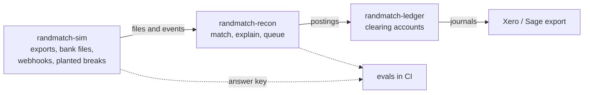

# randmatch-recon

Payout reconciliation for South African merchants who take payments through several providers.

> **Status: in design.** The problem, the first decisions and the way this repository is built are
> written down. Code lands spec-first, one feature at a time.

This is the product. It takes what each provider and bank says happened, works out what each payout is made of, and shows what doesn't match and why.

## Scope

- **Ingest** provider settlement exports (Yoco, Peach, Paystack, Payfast, Ozow), bank CSV and
  OFX, and ISO 20022 `camt.053` statements, validated against their XSD. One bad row is
  rejected with a reason; it doesn't sink the file.
- **Decompose** each net payout back into sales, fees, refunds, chargebacks and holds, including
  many-to-one matches (one deposit covering a day of sales).
- **Match** with pluggable rules, one class per break type, so a new rule is added without
  editing a switch.
- **Queue** every exception with its reason, its age and who is working it. Every action is
  audited.
- **Explain** an unmatched item with an AI break-explainer that cites the rows it read, writes
  an audit row per call, is scored against `randmatch-sim`'s planted breaks in CI, and never
  posts on its own.
- **Tenants:** a bookkeeper firm is a tenant, and its merchants sit under it. Roles: Owner,
  Reviewer, Read-only.

## How it fits

| Repo | Role |
|---|---|
| [randmatch-recon](https://github.com/MorenaDlamini/randmatch-recon) | The product: ingestion, matching, the exceptions queue, the AI break-explainer |
| [randmatch-ledger](https://github.com/MorenaDlamini/randmatch-ledger) | The double-entry clearing ledger: postings, journal export, audit |
| [randmatch-sim](https://github.com/MorenaDlamini/randmatch-sim) | The simulator: provider exports, bank files and webhooks with planted breaks |

## Stack

ASP.NET Core and EF Core on **SQL Server** (T-SQL where the matching queries need it, with tuning write-ups in `docs/perf/`); **React + TypeScript + Tailwind**; `Microsoft.Extensions.AI` with Azure OpenAI, Anthropic and Bedrock behind one `IChatClient`; a read-only MCP server. Deployed to **Azure**: Container Apps, Azure SQL, Key Vault, Application Insights, a Function for file-drop ingest, Service Bus. Infrastructure in **Bicep**; pipelines in **Azure DevOps** (UAT, approval, production) alongside GitHub Actions.

## How it's built

- **Spec before code.** A feature's `spec.md` and `plan.md` are merged before any implementation
  ([specs/](specs/README.md)).
- **Decisions are recorded**, with what AI proposed and what I rejected:
  - [SQL Server for reconciliation](docs/adr/0001-sql-server-for-reconciliation.md)
  - [Azure for recon, AWS for the ledger](docs/adr/0002-cloud-split-azure-recon-aws-ledger.md)
- **AI is visible.** Every PR records what an assistant generated and how its review findings were
  triaged ([standards](docs/ai-engineering/standards.md), [PR template](.github/pull_request_template.md)).
- **Tests name their risk**, and core logic is mutation-tested.

## Measured results

None yet. Each one is published here with how it was measured:

- Match rate and false-match rate against `randmatch-sim`'s planted breaks
- Eval pass rate for break explanations whose cited rows exist and support the claim
- Query timings before and after tuning, with execution plans
- A pilot bookkeeper's month-close effort against their own Excel baseline, self-reported

## What this is not

- **Synthetic data**, or your own exports processed locally. No real merchant data is stored or
  sent to a model.
- **Not PayShap-conformant.** The PayShap message specification isn't public; anything shaped
  like it here is an approximation.
- **No card numbers.** No PANs are handled, so nothing here is in PCI DSS scope.
- **The AI never posts.** It explains and suggests; a person accepts or rejects.
- **Unaffiliated.** Payment providers, banks and accounting tools are named only to describe the
  shape of their public data. None of them endorses or is connected to this project.

## License

[MIT](LICENSE)
